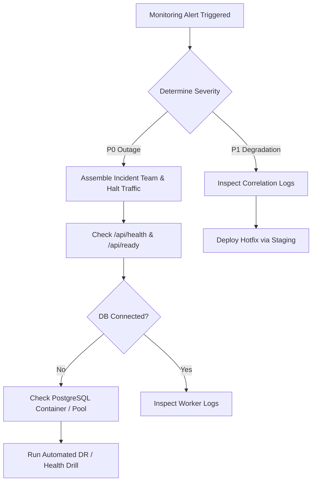

# NEXORA Commerce — Release Management & Operations Runbook

**Version:** 1.0  
**Phase:** Phase 10 Production Infrastructure & Staging Verification  
**Applies to:** Engineering, DevOps, Platform Administrators

---

## 1. Production Go / No-Go Checklist

A release candidate may only be promoted to production if all gates evaluate to **GO**:

| Gate | Verification Check | Required Result | Verified Status |
| :--- | :--- | :---: | :---: |
| **G-01** | Test Suite Execution | `vitest run` 100% pass | **GO** |
| **G-02** | End-to-End Regression | `playwright test` 100% pass | **GO** |
| **G-03** | TypeScript Typecheck | `tsc --noEmit` exit code 0 | **GO** |
| **G-04** | ESLint Code Quality | `npm run lint` exit code 0 | **GO** |
| **G-05** | Production Next.js Build | `npm run build` cleanly compiled | **GO** |
| **G-06** | Database Migration Safety | `prisma migrate status` up-to-date | **GO** |
| **G-07** | Backup & DR Verification | Pre-deployment dump verified | **GO** |
| **G-08** | Environment Separation | Prod secrets in vault, no mocks in prod | **GO** |
| **G-09** | Background Worker | Worker process verified in container | **GO** |
| **G-10** | Authorized Human Sign-Off | Explicit deployment approval | **GO** |

---

## 2. Pre-Deployment Checklist

Before triggering a staging or production release:
1. Verify working directory is clean: `git status`.
2. Confirm active Git tag matches intended release version (e.g. `v1.0.0-rc1`).
3. Generate fresh verified PostgreSQL database dump:
   ```bash
   powershell -Command "docker exec -e PGPASSWORD=nexora_password nexora-postgres pg_dump -U nexora -d nexora_db -F p > prisma/backup_pre_release.sql"
   ```
4. Verify `.env` configuration via startup validator:
   ```bash
   npx tsx -e "import { validateEnv } from './src/lib/env-validator'; validateEnv();"
   ```
5. Confirm that `ALLOW_MOCK_PAYMENT` is strictly `false` in production.

---

## 3. Database Migration Checklist & Procedure

1. **Pre-Migration Safety Verification:**
   ```bash
   npx prisma migrate status
   ```
2. **Execute Deployment Migrations:**
   ```bash
   npm run db:deploy
   ```
   *(Uses `prisma migrate deploy` — never `prisma migrate dev` or `prisma db push` in production).*
3. **Data Parity Check:**
   Verify business and product counts post-migration:
   ```bash
   npx tsx -e "import { prisma } from './src/lib/prisma'; prisma.business.count().then(c => console.log('Active Businesses:', c));"
   ```

---

## 4. Rollback Procedure & Disaster Recovery

If an anomaly occurs post-deployment:

### Immediate Application Rollback
1. Revert container image tag to previous stable release:
   ```bash
   docker compose -f docker-compose.prod.yml down
   # Switch image tag in compose to previous stable version
   docker compose -f docker-compose.prod.yml up -d
   ```
2. Run health probes:
   ```bash
   curl -f http://localhost:3000/api/health
   curl -f http://localhost:3000/api/ready
   ```

### Database Restoration Procedure
1. Terminate active database connections:
   ```sql
   SELECT pg_terminate_backend(pid) FROM pg_stat_activity WHERE datname = 'nexora_db' AND pid <> pg_backend_pid();
   ```
2. Restore clean pre-deployment backup:
   ```bash
   docker exec -i nexora-postgres psql -U nexora -d nexora_db < prisma/backup_pre_release.sql
   ```
3. Restart application containers to refresh connection pools.

---

## 5. Secrets Rotation Runbook

Rotate secrets every 90 days or immediately upon suspected compromise:

### 1. Better Auth Session Secret
- **Variable:** `BETTER_AUTH_SECRET`
- **Impact:** Existing user sessions will be invalidated; users must re-authenticate.
- **Procedure:**
  1. Generate new 64-character random key: `openssl rand -base64 48`.
  2. Update in secrets vault.
  3. Redeploy application containers.

### 2. SaaS Billing Webhook Secret
- **Variable:** `SAAS_BILLING_WEBHOOK_SECRET`
- **Procedure:**
  1. Update secret in external billing provider console.
  2. Simultaneously update in container environment.
  3. Test simulated webhook to verify HMAC validation.

### 3. Database Credentials
- **Procedure:**
  1. Create secondary database user with identical permissions in PostgreSQL.
  2. Update `DATABASE_URL` in application secrets vault.
  3. Deploy application.
  4. Revoke permissions and drop old database user.

---

## 6. Incident Response & Triage Runbook

### Severity Levels
- **P0 (Critical Outage):** Complete storefront downtime, payment processing failure, data corruption. Response time: `< 15 minutes`.
- **P1 (Major Issue):** Specific store unavailable, email notifications failing, worker stopped. Response time: `< 1 hour`.
- **P2 (Minor Bug):** UI glitch, theme preview lag, non-critical report error. Response time: `< 24 hours`.

### Incident Triage Workflow

